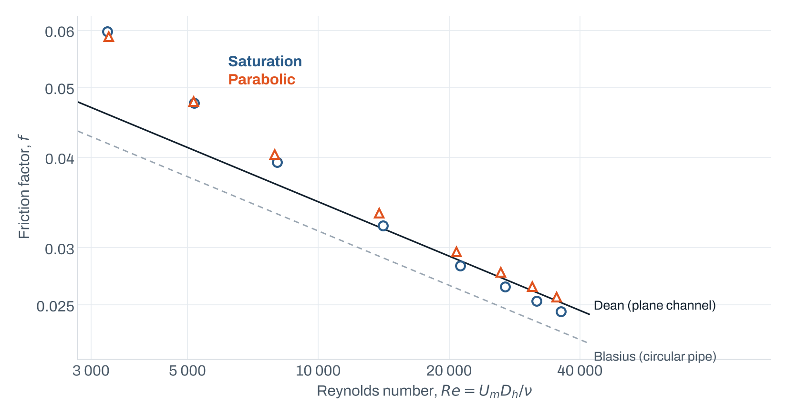
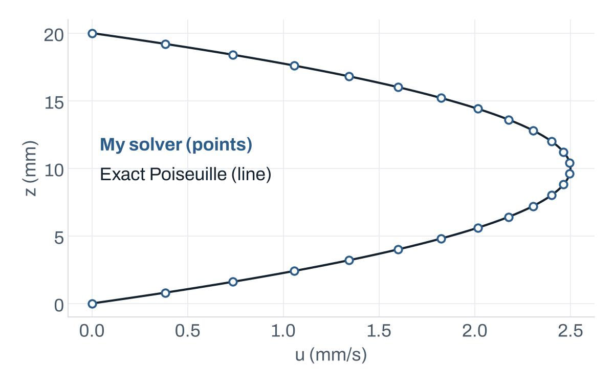
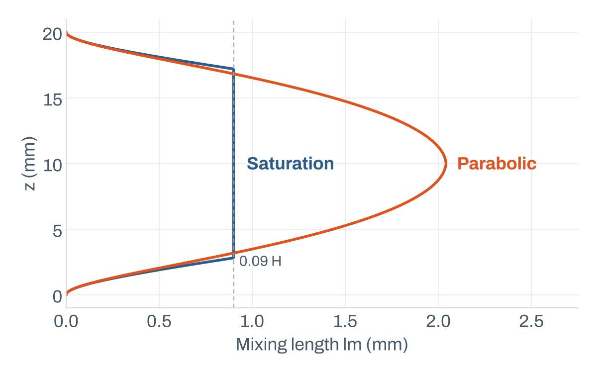
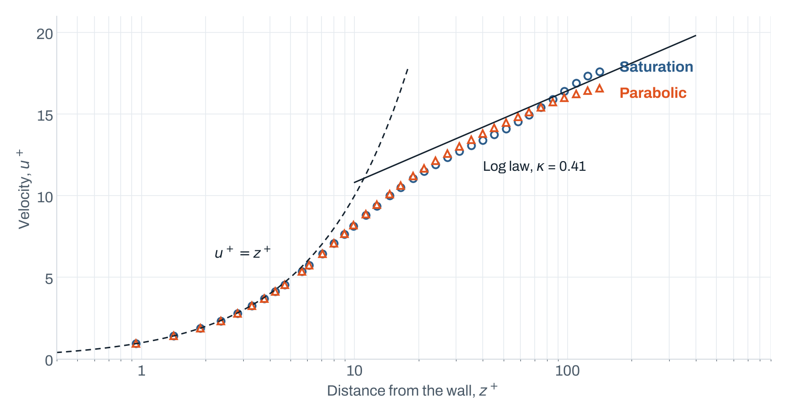

# Turbulent flow in a smooth rectangular duct

A 1D unsteady RANS solver written from scratch in Python. It predicts the mean velocity profile of a pressure-driven flow in a wide, flat duct, with a mixing-length turbulence model and Van Driest wall damping.

M2 MSME numerical project, Université Paul Sabatier Toulouse III, 2026.



## What it does

The duct is much wider than it is high (B ≫ 2H), so the flow reduces to one velocity profile u(z) across the height 2H. The solver integrates

∂u/∂t = −(1/ρ) dp/dx + ∂/∂z [ (ν + ν_t) ∂u/∂z ]

from rest until it reaches a steady state. It uses explicit Euler in time and centred finite differences in space, with a time step adapted to the largest effective viscosity.

1. **Laminar validation.** With ν_t = 0, the result matches the exact Poiseuille profile to 0.005 %.
2. **Turbulence model.** ν_t = l_m² |du/dz|, using Prandtl's mixing length with Van Driest damping (A⁺ = 26, κ = 0.41). Two core models are compared:
   - **saturation**: l_m capped at 0.09 H,
   - **parabolic**: l_m = κ d (1 − d / 2H).
3. **Law of the wall.** Both models follow u⁺ = z⁺ in the viscous sublayer. The saturation model follows the log law more closely towards the centre of the channel.
4. **Moody diagram.** A sweep over eight pressure gradients covers Re ≈ 3 300 to 36 000. Above Re ≈ 14 000, the friction factor stays within 5 % of Dean's correlation for plane channels.

For the reference turbulent case, a momentum balance check (wall shear stress against the pressure gradient) gives a ratio of 0.9999.

| Laminar validation | Mixing length | Law of the wall |
|---|---|---|
|  |  |  |

## Run it

```bash
pip install -r requirements.txt

python main.py laminaire                       # part 1, laminar
python main.py turbulent --modele saturation   # part 2, reference turbulent case
python main.py balayage --modele tous          # Reynolds sweep, both models
python main.py convergence                     # profiles at several times
python main.py tout --modele tous              # everything

python traitement.py --sans-affichage          # summary + figures in resultats/
```

Results are saved as `.npz` files in `resultats/`. The plots are made separately by `traitement.py`.

## Files

| File | Role |
|---|---|
| `main.py` | Parameters and command-line entry point |
| `canal_turbulent.py` | Solver: mesh, laminar and RANS solvers, integral quantities, Reynolds sweep |
| `traitement.py` | Post-processing: numerical summary and all figures |

The code and comments are in French.

## Author

Mohamed Rayan Aissat, [portfolio](https://rayanaissat22-droid.github.io) · [LinkedIn](https://www.linkedin.com/in/mohamed-rayan-aissat-56880b337)
